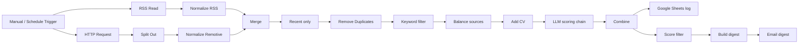

# AI Job Hunter: n8n Workflow

An automated job-search pipeline built in n8n. Every day it collects remote job listings from multiple sources, filters out stale and repeated postings, scores each remaining job against my CV using an LLM (Google Gemini), logs everything to Google Sheets, and emails me a digest of the best matches.

> Built as a hands-on practice project for AI automation and LLM workflow engineering.

---

## Demo

| | |
|---|---|
| Workflow canvas | `screenshots/workflow.png` |
| Sample digest email | `screenshots/email-digest.png` |
| Google Sheet log | `screenshots/sheet-log.png` |
| Video walkthrough | _add link here_ |

---

## The problem

Job boards are noisy. Most listings are irrelevant, many are weeks old, and the same job shows up across several sources. Reading through them every day takes time, and it is easy to miss the few postings that actually fit.

## The solution

A scheduled workflow that does the reading and first-pass screening for me:

1. Pulls fresh listings from several sources
2. Normalizes them into one format
3. Removes old, repeated and irrelevant jobs
4. Uses an LLM to score each job against my CV (0 to 100) with a short explanation
5. Logs every scored job for later analysis
6. Emails me only the strongest matches

---

## Architecture



Data flow in numbers (from a test run): 35 jobs collected, 24 after the recency filter, 20 after the keyword filter, 5 selected for scoring, 1 passed the score threshold and was emailed.

---

## Tech stack

- **n8n**: workflow automation
- **Google Gemini** (via the n8n Basic LLM Chain): job scoring
- **Structured Output Parser** (with Auto-fix): reliable JSON from the model
- **Google Sheets**: persistent log of all scored jobs
- **Gmail**: delivery of the daily digest
- **JavaScript** (Code nodes): source balancing and digest formatting
- **Sources**: We Work Remotely (RSS), Remotive (API)

---

## Node breakdown (22 nodes)

### 1. Triggers (2 nodes)

| Node | Role |
|---|---|
| Manual Trigger | Starts the workflow when I click Execute. Used for testing. |
| Schedule Trigger | Starts the workflow automatically every day at the time I set. Used once it is published. |

### 2. Collecting jobs (5 nodes)

| Node | Role |
|---|---|
| RSS Read | Pulls the We Work Remotely feed (25 jobs). |
| Edit Fields | Converts the RSS data into the standard 6 fields: company, title, description, url, source, date. |
| HTTP Request | Calls the Remotive API (returns 1 item holding a list of jobs). |
| Split Out | Splits that list into separate items (10 jobs). |
| Edit Fields1 | Converts the Remotive data into the same 6 fields, so both sources look identical. |

### 3. Combining and cleaning (5 nodes)

| Node | Role |
|---|---|
| Merge | Joins both sources into one list (25 + 10 = 35 items). |
| Recent only | Drops jobs older than the cutoff (35 → 24). |
| Remove Duplicates | Remembers every job URL from earlier runs and drops any already processed. |
| Filter | Keyword filter that keeps jobs mentioning AI, ML, Python and similar terms (24 → 20). |
| Balance sources | Code node that takes the newest few jobs from each source, so one website does not dominate (20 → 5). |

### 4. AI scoring (5 nodes)

| Node | Role |
|---|---|
| Add CV | Attaches the CV text to every job, so the LLM can compare the two. |
| Basic LLM Chain | Sends each job plus the CV to Gemini and asks for a score and reasoning. |
| Google Gemini Chat Model | The AI model that does the thinking for the chain. |
| Structured Output Parser | Forces the answer into a fixed format (score, verdict, matching skills, missing skills, reason). |
| Google Gemini Chat Model1 | A second model used by Auto-fix, which repairs the answer when the format is wrong. This explains why the parser shows 10 items for 5 jobs. |

### 5. Output (5 nodes)

| Node | Role |
|---|---|
| Combine | Merges the job details (title, company, url) with the AI's score into one clean record. |
| Append row in sheet | Logs every scored job to Google Sheets, so there is a history. |
| Filter1 | Keeps only jobs at or above the score threshold. |
| Build digest | Code node that turns those jobs into one readable email, sorted by score. |
| Send a message | Gmail node that emails the digest. |

---

## LLM scoring

Each job is compared to my CV with a recruiter-style prompt. The model returns structured JSON:

```json
{
  "score": 65,
  "verdict": "possible",
  "matching_skills": ["Python", "LLM applications"],
  "missing_skills": ["Contact center platforms"],
  "reason": "Short explanation of the score."
}
```

The prompt tells the model to use only information present in the CV and the posting, which reduces invented skills.

---

## Setup

1. Import `workflow.json` into n8n (**Workflow menu → Import from file**).
2. Create credentials in n8n for:
   - Google Gemini (API key from Google AI Studio)
   - Google Sheets (OAuth)
   - Gmail (OAuth)
3. Create a Google Sheet with these headers in row 1, in this exact order:
   `date, title, company, url, score, verdict, matching_skills, missing_skills, reason`
4. In the **Add CV** node, replace the placeholder with your own CV text.
5. In the **Append row in sheet** node, select your sheet. In **Send a message**, set your email address.
6. Adjust the settings to taste:
   - Recency cutoff in **Recent only** (days)
   - Keyword list in **Filter**
   - `perSource` in **Balance sources**
   - Score threshold in **Filter1**
7. Test with the Manual Trigger, then publish the workflow so the Schedule Trigger runs daily.

> The exported workflow does not contain credentials. Remove your CV text, email address and Sheet ID before sharing the JSON publicly.

---

## Challenges and what I learned

- **Expressions vs fixed values in n8n.** Several fields silently treated my expressions as plain text until I switched them to Expression mode. Checking the preview under each field became a habit.
- **LLM output format errors.** Smaller models sometimes returned JSON that did not match the schema. I added a Structured Output Parser with Auto-fix, and tuned the prompt.
- **API rate limits (HTTP 429).** The free Gemini tier rejected bursts of requests. I limited the number of jobs per run and enabled retries with a wait between attempts.
- **Missing CV in the prompt.** The model scored every job 0 because the CV field still held a placeholder. Debugging this taught me to inspect each node's input and output.
- **Google Sheets column mismatch.** Header names that did not match the field names caused n8n to create new columns. Fixed by cleaning the headers and mapping columns explicitly.
- **One source dominating results.** A plain Limit node kept only the first jobs, which all came from the first source. I replaced it with a Code node that takes the newest jobs from each source.
- **Stale listings and repeats.** Added a recency filter, and duplicate memory that persists across runs.

---

## Possible improvements

- Add more job sources (more RSS feeds, other APIs)
- Send an email on days with no strong matches (currently handled in the digest code)
- Error-alert workflow using n8n's Error Trigger
- Add a posting date and a "tailored cover letter opener" for high-scoring jobs
- Human-in-the-loop approval (Apply / Skip) and use that feedback to tune the prompt
- Compare scoring between two models and log the differences

---

## Author

_Your name_ · _GitHub / LinkedIn link_
